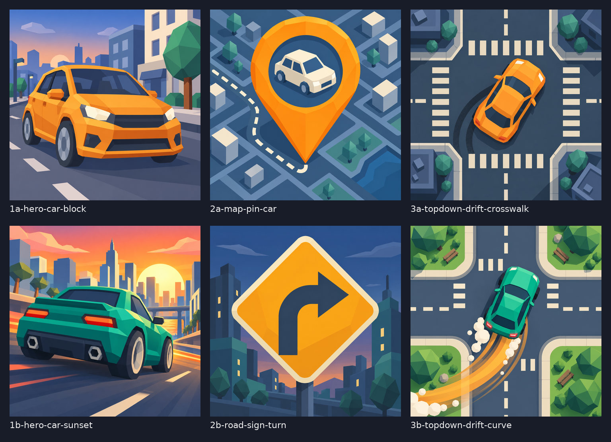

# Task 18: name candidates and icon dry run

Date: 2026-10-16. Agent task 18 of epic `17-city-drive`. Research and drafts only; nothing is applied (task 20 applies the pick, task 19 is the human choice).

## Names

### Method

Following epic 16 task 14 and `.claude/skills/audit-game-and-prepare-for-release/references/07-brand-name-logo.md`, with the task 18 dry-run amendments.

1. **Brainstorm and check 36 names** (needed at least 25), each at most 14 characters, no real car brand, no "Simulator". Script: `namecheck.py` (stdlib Python, reproducible; raw output in `namecheck-results.json`).
2. **Google Play**: `https://play.google.com/store/search?q=<name>&c=apps`, plain and quoted, titles parsed from the page (`DdYX5` spans).
3. **App Store**: iTunes Search API `https://itunes.apple.com/search?term=<name>&entity=software&limit=50`, every `trackName` compared.
4. **Matching rule**: a title that contains the name, contains every word of it, or has a similarity ratio of 0.80 or more is flagged, and each flag is read by hand. Fuzzy or same-genre near matches count as a conflict.
5. **Domains**: RDAP, `.com` via `https://rdap.verisign.com/com/v1/domain/<name>.com` and `.app` via `https://pubapi.registry.google/rdap/domain/<name>.app` (HTTP 404 = available, 200 = registered). Domains are a signal, not a gate.
6. **Web sweep and trademark glance** (shortlisted names only, WebSearch tool, 2026-10-16): `"<name>" game` for each name, plus `"<a>" OR "<b>" OR "<c>" trademark registered` in three batches. None returned a game or a registered mark with these names.
7. **Trademark databases: UNSURE.** USPTO and EUIPO cannot be queried without a browser here, and the amendment does not require it. Every shortlisted name is therefore UNSURE on trademarks (web glance clear). **A formal clearance of the final pick is recommended before launch.**
8. **Independent recheck of the top 3** (`recheck.py`, `recheck-results.json`): 4 query variants each (for example `Honkville game`, `Honk ville`, `TarmacTown`, `Curbside Run`) on Play, and on iTunes in the US, GB and CA storefronts. 48 queries, all HTTP 200, 0 flags. (iTunes country `in` returns zero results for every term, so it was dropped.)

### Shortlist (8 NOT FOUND names, ranked)

| Rank | Name (chars) | Why it fits | .com / .app |
|---|---|---|---|
| 1 | **Honkville** (9) | A town where everybody honks: friendly, instantly sayable, fits missions and traffic in one word. | available / available |
| 2 | **Tarmac Town** (11) | The road surface plus a small stylized city; reads clearly as a driving game in a town. | available / available |
| 3 | **Kerbside Run** (12) | A kerbside run is a delivery or pickup; covers the delivery and taxi missions. Uses the British spelling kerb. | available / available |
| 4 | **Turnpike Town** (13) | A toll-road town; evokes highways and city blocks, strong alliteration. | available / available |
| 5 | **Cobble Cruise** (13) | Cobbled streets plus a relaxed cruise; softer, cosy tone for free roam. | available / available |
| 6 | **Tollgate Town** (13) | A gated town of toll roads; hints at districts that unlock. | available / available |
| 7 | **Honkopolis** (10) | Honk plus metropolis: a whole city of traffic; playful and short. | available / available |
| 8 | **Wheelwick** (9) | Invented place name (wheel plus -wick, like a village); abstract but pronounceable and brandable. | available / available |

All 8 have 5 evidence URLs each in `shortlist.json` (Play plain, Play quoted, iTunes, RDAP .com, RDAP .app), plus the web query below. Trademark verdict for all: UNSURE.

- **Honkville**: web query `"Honkville" game`: no game found. Evidence: [play.google.com](https://play.google.com/store/search?q=Honkville&c=apps) · [play.google.com](https://play.google.com/store/search?q=%22Honkville%22&c=apps) · [itunes.apple.com](https://itunes.apple.com/search?term=Honkville&entity=software&limit=50) · [rdap.verisign.com](https://rdap.verisign.com/com/v1/domain/honkville.com) · [pubapi.registry.google](https://pubapi.registry.google/rdap/domain/honkville.app)
- **Tarmac Town**: web query `"Tarmac Town" game`: no game found. Evidence: [play.google.com](https://play.google.com/store/search?q=Tarmac%20Town&c=apps) · [play.google.com](https://play.google.com/store/search?q=%22Tarmac%20Town%22&c=apps) · [itunes.apple.com](https://itunes.apple.com/search?term=Tarmac%20Town&entity=software&limit=50) · [rdap.verisign.com](https://rdap.verisign.com/com/v1/domain/tarmactown.com) · [pubapi.registry.google](https://pubapi.registry.google/rdap/domain/tarmactown.app)
- **Kerbside Run**: web query `"Kerbside Run" game`: no game found. Evidence: [play.google.com](https://play.google.com/store/search?q=Kerbside%20Run&c=apps) · [play.google.com](https://play.google.com/store/search?q=%22Kerbside%20Run%22&c=apps) · [itunes.apple.com](https://itunes.apple.com/search?term=Kerbside%20Run&entity=software&limit=50) · [rdap.verisign.com](https://rdap.verisign.com/com/v1/domain/kerbsiderun.com) · [pubapi.registry.google](https://pubapi.registry.google/rdap/domain/kerbsiderun.app)
- **Turnpike Town**: web query `"Turnpike Town" game`: no game found. Evidence: [play.google.com](https://play.google.com/store/search?q=Turnpike%20Town&c=apps) · [play.google.com](https://play.google.com/store/search?q=%22Turnpike%20Town%22&c=apps) · [itunes.apple.com](https://itunes.apple.com/search?term=Turnpike%20Town&entity=software&limit=50) · [rdap.verisign.com](https://rdap.verisign.com/com/v1/domain/turnpiketown.com) · [pubapi.registry.google](https://pubapi.registry.google/rdap/domain/turnpiketown.app)
- **Cobble Cruise**: web query `"Cobble Cruise" game`: no game found. Evidence: [play.google.com](https://play.google.com/store/search?q=Cobble%20Cruise&c=apps) · [play.google.com](https://play.google.com/store/search?q=%22Cobble%20Cruise%22&c=apps) · [itunes.apple.com](https://itunes.apple.com/search?term=Cobble%20Cruise&entity=software&limit=50) · [rdap.verisign.com](https://rdap.verisign.com/com/v1/domain/cobblecruise.com) · [pubapi.registry.google](https://pubapi.registry.google/rdap/domain/cobblecruise.app)
- **Tollgate Town**: web query `"Tollgate Town" game`: no game found. Evidence: [play.google.com](https://play.google.com/store/search?q=Tollgate%20Town&c=apps) · [play.google.com](https://play.google.com/store/search?q=%22Tollgate%20Town%22&c=apps) · [itunes.apple.com](https://itunes.apple.com/search?term=Tollgate%20Town&entity=software&limit=50) · [rdap.verisign.com](https://rdap.verisign.com/com/v1/domain/tollgatetown.com) · [pubapi.registry.google](https://pubapi.registry.google/rdap/domain/tollgatetown.app)
- **Honkopolis**: web query `"Honkopolis" game`: no game found. Evidence: [play.google.com](https://play.google.com/store/search?q=Honkopolis&c=apps) · [play.google.com](https://play.google.com/store/search?q=%22Honkopolis%22&c=apps) · [itunes.apple.com](https://itunes.apple.com/search?term=Honkopolis&entity=software&limit=50) · [rdap.verisign.com](https://rdap.verisign.com/com/v1/domain/honkopolis.com) · [pubapi.registry.google](https://pubapi.registry.google/rdap/domain/honkopolis.app)
- **Wheelwick**: web query `"Wheelwick" game app`: no game found. Evidence: [play.google.com](https://play.google.com/store/search?q=Wheelwick&c=apps) · [play.google.com](https://play.google.com/store/search?q=%22Wheelwick%22&c=apps) · [itunes.apple.com](https://itunes.apple.com/search?term=Wheelwick&entity=software&limit=50) · [rdap.verisign.com](https://rdap.verisign.com/com/v1/domain/wheelwick.com) · [pubapi.registry.google](https://pubapi.registry.google/rdap/domain/wheelwick.app)

Notes on the top picks:
- **Honkville**: the strongest all-round candidate: shortest, most playful, both domains free, nothing on any store.
- **Tarmac Town**: clearest "driving in a town" meaning. "Tarmac" is the British word for asphalt; it is understood in the US.
- **Kerbside Run**: best match to the delivery and taxi missions, but "kerb" is the British spelling. A US player may read "Curbside" and search for that. "Curbside Run" was also rechecked and is clear on the stores.

### All 36 candidates checked

Verdicts: **NOT FOUND** = clear on stores and the web sweep (shortlisted). **STORES CLEAR** = clear on Play, iTunes and nothing else checked (not shortlisted: the brainstorm kept the best 8). **EXISTS** / **UNSURE** = conflict or near conflict, with the reason.

| # | Name | Chars | Verdict | Domains | Evidence | Notes |
|---|---|---|---|---|---|---|
| 1 | Kerbside Run | 12 | NOT FOUND | kerbsiderun.com available, kerbsiderun.app available | [Play](https://play.google.com/store/search?q=Kerbside%20Run&c=apps) · [Play quoted](https://play.google.com/store/search?q=%22Kerbside%20Run%22&c=apps) · [iTunes](https://itunes.apple.com/search?term=Kerbside%20Run&entity=software&limit=50) | No exact or near title on Play (plain and quoted) or iTunes. Web sweep clear (see below). |
| 2 | Crosstown Dash | 14 | EXISTS | crosstowndash.com available, crosstowndash.app available | [Play](https://play.google.com/store/search?q=Crosstown%20Dash&c=apps) · [Play quoted](https://play.google.com/store/search?q=%22Crosstown%20Dash%22&c=apps) · [iTunes](https://itunes.apple.com/search?term=Crosstown%20Dash&entity=software&limit=50) | Play and iTunes both have a Crosstown app (0.82 similar); Crosstowne also on Play; crowded Dash genre. |
| 3 | Tarmac Town | 11 | NOT FOUND | tarmactown.com available, tarmactown.app available | [Play](https://play.google.com/store/search?q=Tarmac%20Town&c=apps) · [Play quoted](https://play.google.com/store/search?q=%22Tarmac%20Town%22&c=apps) · [iTunes](https://itunes.apple.com/search?term=Tarmac%20Town&entity=software&limit=50) | No exact or near title on Play (plain and quoted) or iTunes. Web sweep clear (see below). |
| 4 | Gridwheel | 9 | STORES CLEAR | gridwheel.com registered, gridwheel.app available | [Play](https://play.google.com/store/search?q=Gridwheel&c=apps) · [Play quoted](https://play.google.com/store/search?q=%22Gridwheel%22&c=apps) · [iTunes](https://itunes.apple.com/search?term=Gridwheel&entity=software&limit=50) | No exact or near title on Play (plain and quoted) or iTunes. Not shortlisted, so no web sweep. |
| 5 | Midtown Mile | 12 | STORES CLEAR | midtownmile.com registered, midtownmile.app available | [Play](https://play.google.com/store/search?q=Midtown%20Mile&c=apps) · [Play quoted](https://play.google.com/store/search?q=%22Midtown%20Mile%22&c=apps) · [iTunes](https://itunes.apple.com/search?term=Midtown%20Mile&entity=software&limit=50) | No exact or near title on Play (plain and quoted) or iTunes. Not shortlisted, so no web sweep. |
| 6 | Lanewise | 8 | STORES CLEAR | lanewise.com registered, lanewise.app registered | [Play](https://play.google.com/store/search?q=Lanewise&c=apps) · [Play quoted](https://play.google.com/store/search?q=%22Lanewise%22&c=apps) · [iTunes](https://itunes.apple.com/search?term=Lanewise&entity=software&limit=50) | No exact or near title on Play (plain and quoted) or iTunes. Not shortlisted, so no web sweep. |
| 7 | Honkville | 9 | NOT FOUND | honkville.com available, honkville.app available | [Play](https://play.google.com/store/search?q=Honkville&c=apps) · [Play quoted](https://play.google.com/store/search?q=%22Honkville%22&c=apps) · [iTunes](https://itunes.apple.com/search?term=Honkville&entity=software&limit=50) | No exact or near title on Play (plain and quoted) or iTunes. Web sweep clear (see below). |
| 8 | Wheelwick | 9 | NOT FOUND | wheelwick.com available, wheelwick.app available | [Play](https://play.google.com/store/search?q=Wheelwick&c=apps) · [Play quoted](https://play.google.com/store/search?q=%22Wheelwick%22&c=apps) · [iTunes](https://itunes.apple.com/search?term=Wheelwick&entity=software&limit=50) | No exact or near title on Play (plain and quoted) or iTunes. Web sweep clear (see below). |
| 9 | Blockrunner | 11 | EXISTS | blockrunner.com registered, blockrunner.app registered | [Play](https://play.google.com/store/search?q=Blockrunner&c=apps) · [Play quoted](https://play.google.com/store/search?q=%22Blockrunner%22&c=apps) · [iTunes](https://itunes.apple.com/search?term=Blockrunner&entity=software&limit=50) | Play has Block Runner, Block runner, Mine Block Runner, Snake Block Runner and 9 more same-word titles; iTunes has Block Runners. |
| 10 | Streetlark | 10 | UNSURE | streetlark.com registered, streetlark.app available | [Play](https://play.google.com/store/search?q=Streetlark&c=apps) · [Play quoted](https://play.google.com/store/search?q=%22Streetlark%22&c=apps) · [iTunes](https://itunes.apple.com/search?term=Streetlark&entity=software&limit=50) | Play has Street Link (0.80); .com registered; weak near match. |
| 11 | Citylark | 8 | STORES CLEAR | citylark.com registered, citylark.app registered | [Play](https://play.google.com/store/search?q=Citylark&c=apps) · [Play quoted](https://play.google.com/store/search?q=%22Citylark%22&c=apps) · [iTunes](https://itunes.apple.com/search?term=Citylark&entity=software&limit=50) | No exact or near title on Play (plain and quoted) or iTunes. Not shortlisted, so no web sweep. |
| 12 | Turnpike Town | 13 | NOT FOUND | turnpiketown.com available, turnpiketown.app available | [Play](https://play.google.com/store/search?q=Turnpike%20Town&c=apps) · [Play quoted](https://play.google.com/store/search?q=%22Turnpike%20Town%22&c=apps) · [iTunes](https://itunes.apple.com/search?term=Turnpike%20Town&entity=software&limit=50) | No exact or near title on Play (plain and quoted) or iTunes. Web sweep clear (see below). |
| 13 | Tailpipe Town | 13 | STORES CLEAR | tailpipetown.com available, tailpipetown.app available | [Play](https://play.google.com/store/search?q=Tailpipe%20Town&c=apps) · [Play quoted](https://play.google.com/store/search?q=%22Tailpipe%20Town%22&c=apps) · [iTunes](https://itunes.apple.com/search?term=Tailpipe%20Town&entity=software&limit=50) | No exact or near title on Play (plain and quoted) or iTunes. Not shortlisted, so no web sweep. |
| 14 | Cobble Cruise | 13 | NOT FOUND | cobblecruise.com available, cobblecruise.app available | [Play](https://play.google.com/store/search?q=Cobble%20Cruise&c=apps) · [Play quoted](https://play.google.com/store/search?q=%22Cobble%20Cruise%22&c=apps) · [iTunes](https://itunes.apple.com/search?term=Cobble%20Cruise&entity=software&limit=50) | No exact or near title on Play (plain and quoted) or iTunes. Web sweep clear (see below). |
| 15 | Tinytown Drive | 14 | STORES CLEAR | tinytowndrive.com available, tinytowndrive.app available | [Play](https://play.google.com/store/search?q=Tinytown%20Drive&c=apps) · [Play quoted](https://play.google.com/store/search?q=%22Tinytown%20Drive%22&c=apps) · [iTunes](https://itunes.apple.com/search?term=Tinytown%20Drive&entity=software&limit=50) | No exact or near title on Play (plain and quoted) or iTunes. Not shortlisted, so no web sweep. |
| 16 | Dashville | 9 | STORES CLEAR | dashville.com registered, dashville.app available | [Play](https://play.google.com/store/search?q=Dashville&c=apps) · [Play quoted](https://play.google.com/store/search?q=%22Dashville%22&c=apps) · [iTunes](https://itunes.apple.com/search?term=Dashville&entity=software&limit=50) | No exact or near title on Play (plain and quoted) or iTunes. Not shortlisted, so no web sweep. |
| 17 | Honk Hollow | 11 | STORES CLEAR | honkhollow.com available, honkhollow.app available | [Play](https://play.google.com/store/search?q=Honk%20Hollow&c=apps) · [Play quoted](https://play.google.com/store/search?q=%22Honk%20Hollow%22&c=apps) · [iTunes](https://itunes.apple.com/search?term=Honk%20Hollow&entity=software&limit=50) | No exact or near title on Play (plain and quoted) or iTunes. Not shortlisted, so no web sweep. |
| 18 | Wheelhaven | 10 | STORES CLEAR | wheelhaven.com registered, wheelhaven.app available | [Play](https://play.google.com/store/search?q=Wheelhaven&c=apps) · [Play quoted](https://play.google.com/store/search?q=%22Wheelhaven%22&c=apps) · [iTunes](https://itunes.apple.com/search?term=Wheelhaven&entity=software&limit=50) | No exact or near title on Play (plain and quoted) or iTunes. Not shortlisted, so no web sweep. |
| 19 | Kerbcrawl | 9 | STORES CLEAR | kerbcrawl.com registered, kerbcrawl.app available | [Play](https://play.google.com/store/search?q=Kerbcrawl&c=apps) · [Play quoted](https://play.google.com/store/search?q=%22Kerbcrawl%22&c=apps) · [iTunes](https://itunes.apple.com/search?term=Kerbcrawl&entity=software&limit=50) | No exact or near title on Play (plain and quoted) or iTunes. Not shortlisted, so no web sweep. |
| 20 | Loopline Lane | 13 | EXISTS | looplinelane.com available, looplinelane.app available | [Play](https://play.google.com/store/search?q=Loopline%20Lane&c=apps) · [Play quoted](https://play.google.com/store/search?q=%22Loopline%20Lane%22&c=apps) · [iTunes](https://itunes.apple.com/search?term=Loopline%20Lane&entity=software&limit=50) | Play has Loopline and Loopline: Car Jam Puzzle: same first word, a car game. |
| 21 | Cruise Quarter | 14 | STORES CLEAR | cruisequarter.com available, cruisequarter.app available | [Play](https://play.google.com/store/search?q=Cruise%20Quarter&c=apps) · [Play quoted](https://play.google.com/store/search?q=%22Cruise%20Quarter%22&c=apps) · [iTunes](https://itunes.apple.com/search?term=Cruise%20Quarter&entity=software&limit=50) | No exact or near title on Play (plain and quoted) or iTunes. Not shortlisted, so no web sweep. |
| 22 | Blockbeat | 9 | EXISTS | blockbeat.com registered, blockbeat.app registered | [Play](https://play.google.com/store/search?q=Blockbeat&c=apps) · [Play quoted](https://play.google.com/store/search?q=%22Blockbeat%22&c=apps) · [iTunes](https://itunes.apple.com/search?term=Blockbeat&entity=software&limit=50) | Play has Block Beat and BlockBeats; iTunes has BlockBeats; .com and .app both registered. |
| 23 | Streetwheel | 11 | UNSURE | streetwheel.com registered, streetwheel.app available | [Play](https://play.google.com/store/search?q=Streetwheel&c=apps) · [Play quoted](https://play.google.com/store/search?q=%22Streetwheel%22&c=apps) · [iTunes](https://itunes.apple.com/search?term=Streetwheel&entity=software&limit=50) | Play has Night Street Wheel (contains); .com registered. |
| 24 | Mileblock | 9 | STORES CLEAR | mileblock.com registered, mileblock.app available | [Play](https://play.google.com/store/search?q=Mileblock&c=apps) · [Play quoted](https://play.google.com/store/search?q=%22Mileblock%22&c=apps) · [iTunes](https://itunes.apple.com/search?term=Mileblock&entity=software&limit=50) | No exact or near title on Play (plain and quoted) or iTunes. Not shortlisted, so no web sweep. |
| 25 | Driftburg | 9 | STORES CLEAR | driftburg.com available, driftburg.app available | [Play](https://play.google.com/store/search?q=Driftburg&c=apps) · [Play quoted](https://play.google.com/store/search?q=%22Driftburg%22&c=apps) · [iTunes](https://itunes.apple.com/search?term=Driftburg&entity=software&limit=50) | No exact or near title on Play (plain and quoted) or iTunes. Not shortlisted, so no web sweep. |
| 26 | Wheelburg | 9 | STORES CLEAR | wheelburg.com available, wheelburg.app available | [Play](https://play.google.com/store/search?q=Wheelburg&c=apps) · [Play quoted](https://play.google.com/store/search?q=%22Wheelburg%22&c=apps) · [iTunes](https://itunes.apple.com/search?term=Wheelburg&entity=software&limit=50) | No exact or near title on Play (plain and quoted) or iTunes. Not shortlisted, so no web sweep. |
| 27 | Honkopolis | 10 | NOT FOUND | honkopolis.com available, honkopolis.app available | [Play](https://play.google.com/store/search?q=Honkopolis&c=apps) · [Play quoted](https://play.google.com/store/search?q=%22Honkopolis%22&c=apps) · [iTunes](https://itunes.apple.com/search?term=Honkopolis&entity=software&limit=50) | No exact or near title on Play (plain and quoted) or iTunes. Web sweep clear (see below). |
| 28 | Metro Meander | 13 | STORES CLEAR | metromeander.com registered, metromeander.app available | [Play](https://play.google.com/store/search?q=Metro%20Meander&c=apps) · [Play quoted](https://play.google.com/store/search?q=%22Metro%20Meander%22&c=apps) · [iTunes](https://itunes.apple.com/search?term=Metro%20Meander&entity=software&limit=50) | No exact or near title on Play (plain and quoted) or iTunes. Not shortlisted, so no web sweep. |
| 29 | Lamppost Lane | 13 | UNSURE | lamppostlane.com available, lamppostlane.app available | [Play](https://play.google.com/store/search?q=Lamppost%20Lane&c=apps) · [Play quoted](https://play.google.com/store/search?q=%22Lamppost%20Lane%22&c=apps) · [iTunes](https://itunes.apple.com/search?term=Lamppost%20Lane&entity=software&limit=50) | Play has an app named Lamppost (0.80 similar) and Lampost; weak but a near title. |
| 30 | Zipzone | 7 | EXISTS | zipzone.com registered, zipzone.app available | [Play](https://play.google.com/store/search?q=Zipzone&c=apps) · [Play quoted](https://play.google.com/store/search?q=%22Zipzone%22&c=apps) · [iTunes](https://itunes.apple.com/search?term=Zipzone&entity=software&limit=50) | iTunes has Zip Zone Express Mobile (contains the name); Play Zim-Zone; .com registered. |
| 31 | Zebra Crossing | 14 | STORES CLEAR | zebracrossing.com registered, zebracrossing.app available | [Play](https://play.google.com/store/search?q=Zebra%20Crossing&c=apps) · [Play quoted](https://play.google.com/store/search?q=%22Zebra%20Crossing%22&c=apps) · [iTunes](https://itunes.apple.com/search?term=Zebra%20Crossing&entity=software&limit=50) | No exact or near title on Play (plain and quoted) or iTunes. Not shortlisted, so no web sweep. Generic phrase (a pedestrian crossing), weak as a brand. |
| 32 | Roundabout Run | 14 | EXISTS | roundaboutrun.com available, roundaboutrun.app available | [Play](https://play.google.com/store/search?q=Roundabout%20Run&c=apps) · [Play quoted](https://play.google.com/store/search?q=%22Roundabout%20Run%22&c=apps) · [iTunes](https://itunes.apple.com/search?term=Roundabout%20Run&entity=software&limit=50) | Play and iTunes have Roundabout 2: City Driving Sim, Roundabout: Sports Car Sim, Roundabout Rush and Roundabouts!: same word in the same genre. |
| 33 | Gridlane | 8 | EXISTS | gridlane.com registered, gridlane.app registered | [Play](https://play.google.com/store/search?q=Gridlane&c=apps) · [Play quoted](https://play.google.com/store/search?q=%22Gridlane%22&c=apps) · [iTunes](https://itunes.apple.com/search?term=Gridlane&entity=software&limit=50) | iTunes has an exact app named Gridlane; Play has two Gridline apps; .com and .app registered. |
| 34 | Pavement Pilot | 14 | STORES CLEAR | pavementpilot.com registered, pavementpilot.app available | [Play](https://play.google.com/store/search?q=Pavement%20Pilot&c=apps) · [Play quoted](https://play.google.com/store/search?q=%22Pavement%20Pilot%22&c=apps) · [iTunes](https://itunes.apple.com/search?term=Pavement%20Pilot&entity=software&limit=50) | No exact or near title on Play (plain and quoted) or iTunes. Not shortlisted, so no web sweep. |
| 35 | Tollgate Town | 13 | NOT FOUND | tollgatetown.com available, tollgatetown.app available | [Play](https://play.google.com/store/search?q=Tollgate%20Town&c=apps) · [Play quoted](https://play.google.com/store/search?q=%22Tollgate%20Town%22&c=apps) · [iTunes](https://itunes.apple.com/search?term=Tollgate%20Town&entity=software&limit=50) | No exact or near title on Play (plain and quoted) or iTunes. Web sweep clear (see below). |
| 36 | Crosswind City | 14 | STORES CLEAR | crosswindcity.com available, crosswindcity.app available | [Play](https://play.google.com/store/search?q=Crosswind%20City&c=apps) · [Play quoted](https://play.google.com/store/search?q=%22Crosswind%20City%22&c=apps) · [iTunes](https://itunes.apple.com/search?term=Crosswind%20City&entity=software&limit=50) | No exact or near title on Play (plain and quoted) or iTunes. Not shortlisted, so no web sweep. |

## Icon drafts

### Smoke test

The first image (`1a`) was the smoke test. An earlier run from the repo working directory did not produce a file: codex read the repo instructions and ended without calling the image tool (exit 0, no PNG, nothing written). Re-run from a scratch working directory (`codex exec ... -C /data/tools/tmp/18`) it generated and saved the PNG, so no block. The image tool returns 1254x1254; each image was downscaled to 1024x1024 with Pillow (LANCZOS). All 6 images are real model output; none is code-drawn or downloaded.

### Images (6, 1024x1024, no text)

Prompt, model and params for each are in `icon-prompts.json` (model `gpt-6.1-sol` driving the codex image tool; the tool takes no size or quality flags).

| Direction | Variant A | Variant B |
|---|---|---|
| 1. Hero car, three-quarter view on a city block | `icons/1a-hero-car-block.png`: amber hatchback, dusk street | `icons/1b-hero-car-sunset.png`: teal coupe, sunset skyline, speed streaks |
| 2. Road-sign or map-pin mark | `icons/2a-map-pin-car.png`: amber map pin with a car inside, city map | `icons/2b-road-sign-turn.png`: amber diamond sign with a turn arrow, skyline |
| 3. Top-down car drifting on an intersection | `icons/3a-topdown-drift-crosswalk.png`: amber car, crosswalks, skid marks | `icons/3b-topdown-drift-curve.png`: teal car, amber drift trail, smoke, parks |

`small-size-strip.png` shows each at 96 px and 48 px. Row order matches the contact sheet (1a, 2a, 3a, 1b, 2b, 3b).

### Checks

- No text, letters, numbers or logos in any image (viewed on the contact sheet). No car shows a real brand badge (generic designs).
- Palette matches the game: amber/orange, slate-blue, cream, teal-green. Style is flat low-poly in the Kenney manner (a model imitation, not Kenney assets).
- Caveat: these are AI-generated raster drafts for choosing a direction. The final icon (task 20) is regenerated at higher quality with the chosen name in mind (the icon itself carries no text).
- `git status --porcelain` after generation shows only this folder, the task file and STATUS.md; no stray files. Scratch (`/data/tools/tmp/18`) is deleted.

## Recommendation

- **Name:** **Honkville** (first), with **Tarmac Town** and **Kerbside Run** as backups. All three passed the strict store check and the independent recheck, and have both domains free. Get a formal trademark clearance on the final pick.
- **Icon:** direction 1, variant **1b** (teal coupe at sunset): the most striking at 48 px and the closest to a store-listing hero. **2a** (map pin) is the best alternative: simplest silhouette, and it signals missions, but it looks like a navigation app. The top-down directions (3a, 3b) read well but look generic next to other driving games.

## Files

- `shortlist.json`, `name-table.md` (the all-names table), `namecheck.py`, `namecheck-results.json`, `recheck.py`, `recheck-results.json`
- `icons/*.png`, `icon-prompts.json`, `contact-sheet.png`, `small-size-strip.png`
